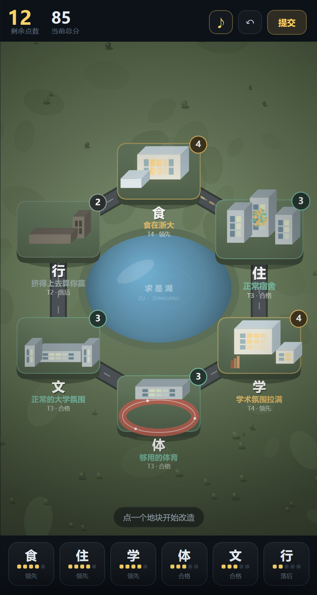

# 紫金港改造计划

一个「给浙大加点」的浏览器小游戏：六个维度、一张校园地图、四个回合。
用技能树加点的思路改造一所大学——升档花点数，降档退点数，一局 3–5 分钟。

> 同人创作，与浙江大学官方无关。代码以 MIT 协议开源，见 [LICENSE](LICENSE)。



---

## 现在怎么玩

**不想碰终端：双击这两个文件**

| 文件 | 作用 |
|---|---|
| `内测启动.bat` | 启动游戏 + 公网隧道，自动打开浏览器。黑色窗口**别关**，地址在里面 |
| `管理后台.bat` | 一个页面里放所有入口：看板 / 按年级 / 对局 / 备份 / 文案 / 公网地址，外加「立即备份」「导出 CSV」 |

停止：关掉黑色窗口（或窗口里按 `Ctrl+C`）。

如果 `.bat` 提示找不到 Node：装一个 [Node.js](https://nodejs.org)（LTS 即可）；或者把你电脑上 `node.exe` 的完整路径写进根目录的 `node-path.txt`（一行纯路径，这个文件不会进 git）。

**只想发给朋友玩**：直接发 `dist/紫金港改造计划.html`，单文件、离线、双击就开（数据不会上报）。

---

**想用命令行：**

```bash
# 需要一个静态服务（不要直接双击 index.html，脚本用的是相对路径 + canvas）
node tools/serve.js 8123
# 打开 http://127.0.0.1:8123/h5/
```

调试参数：

| 参数 | 作用 |
|---|---|
| `?demo=map` | 直接进入一局并做两步改造（看地图） |
| `?demo=sheet` | 同上，并打开「住」的详情抽屉 |
| `?demo=event` | 直接触发一张事件卡 |
| `?demo=result` | 直接看结算页 |
| `?demo=share` | 直接看战绩图 |
| `?demo=tap` | 手势自测：模拟「点地块 + 浏览器补发 click」，检查面板不会被误关 |
| `?debug=1` | 把 JS 报错显示在页面底部 |

手机端说明：地图地块和底部六个图标都是**单击**生效，不需要长按。
（曾经的坑：手机上 tap 会在手指抬起后补发一个 `click`，如果遮罩用 `click` 关闭，那一下点击会把刚打开的面板当场关掉，表现为「必须长按」。现在遮罩改为 `pointerdown` 关闭，并忽略打开后 400ms 内的点击。）

---

## 转发给别人

三种方式，按「对方在哪」选。

### 1. 发文件（最省事，不需要服务器、不需要联网）

`dist/紫金港改造计划.html` —— **97 KB 单文件**，CSS/JS 全部内联，双击就能玩。

- 微信 / 邮件 / QQ 直接把文件发过去
- iPhone：微信里点开文件 → 右上角「用其他应用打开」→ 存到「文件」App → 用 Safari 打开
- Android：下载后用 Chrome 打开
- 改过源码要重新打包：`node tools/build-single.js`

### 2. 同一 WiFi 发链接

```bash
node tools/serve.js 8123
```

终端会打印 `http://<你的局域网 IP>:8123/h5/`，把这条发给同网络的人即可。
Windows 防火墙默认拦截入站连接，需要放行一次（**管理员** PowerShell）：

```powershell
New-NetFirewallRule -DisplayName "ZJU Remake 8123" -Direction Inbound -Protocol TCP -LocalPort 8123 -Action Allow
```

### 3. 公网链接（发给不在身边的人）

`dist/site/` 就是一个可以直接托管的静态站（`index.html` 在根路径，无构建、无依赖）。

- **Cloudflare Pages**：Dash → Workers & Pages → Create → Pages → Upload assets → 把 `dist/site` 整个文件夹拖进去 → 得到 `https://xxx.pages.dev`
- **Netlify Drop**：`app.netlify.com/drop` 拖 `dist/site` 同理
- **GitHub Pages**：把 `dist/site/index.html` 传到仓库根目录，Settings → Pages 开启
- ⚠️ 腾讯云 COS / 阿里云 OSS 的默认域名会对 `text/html` 强制下载，必须绑自定义域名才能直接预览

### 只想转发「战绩」

结算页点「保存战绩图」→ 得到一张 750×1180 的 PNG → 直接发朋友圈/群。

---

## 发给别人 + 把他的数据收回自己电脑

一句话：**你的电脑必须能被公网访问**，文件本身不会自己飞回来。所以要么开一条隧道，要么上云。

### 方式一：发链接（推荐，最稳）

```bash
node tools/serve.js 8123      # 一个进程：游戏 + 收集 + 看板（同源，没有跨域问题）
node tools/tunnel.js          # 第一次跑加 --download（会自动下 cloudflared）
```

隧道会打印一个 `https://xxx.trycloudflare.com`：

- 发给对方：`https://xxx.trycloudflare.com/play`
- 自己看数据：同域名 `/dashboard`，或本地 `http://127.0.0.1:8123/dashboard`

数据直接追加进你电脑的 `data/events.jsonl`。

注意：

- 链接有效期 = 隧道进程开着的时间；重启会换新域名
- 想要固定域名，用 Cloudflare 免费账号建 named tunnel（`cloudflared tunnel create`）
- 电脑睡眠 / 关机就断
- **看板默认只在本机开放**：通过隧道访问 `/dashboard` 或 `/stats` 会返回 403，别人只能玩游戏、看不到别人的数据。确实需要公网看板时加 `--public-dashboard`
- 服务端只对外提供 `h5/ game/ render/ dist/` 四个目录；`data/`（玩家数据）、`tools/`、`README` 都取不到

### 方式二：发文件（微信发文件更自然）

```bash
node tools/build-single.js --collect=https://xxx.trycloudflare.com/collect --out=浙大改造.html
```

把 `dist/浙大改造.html` 发过去，对方双击就能玩，数据会 POST 到你隧道的 `/collect`。

- ✅ Chrome / Edge 实测可用（`file://` → `http(s)` 带 CORS `*` 可以过）
- ⚠️ iOS Safari 不保证，iPhone 用户建议直接发链接
- 你的服务没开的时候：数据先留在对方浏览器（能写 localStorage 的浏览器会在下次打开、且你的服务在线时补发）
- 这个文件里写着你的地址；地址别带 token 之类的敏感信息

### 方式三：长期在线（不用一直开着电脑）

`dist/site` 扔到 Cloudflare Pages，收集用 Worker + KV（代码见上一节），然后随时拉回本地：

```bash
curl -s https://xxx.workers.dev/stats -o stats.json    # 聚合结果
node tools/report.js data/events.jsonl                 # 有原始数据时
```

### 兜底：同一 WiFi

```bash
node tools/serve.js 8123
# 发 http://<你的局域网IP>:8123/play
```

需要先放行 8123 端口（管理员 PowerShell 跑一次 `New-NetFirewallRule`，命令见上一节）。

### 需要买云服务器吗？

**不需要。** 三档成本，按你的阶段选：

| 方案 | 花钱 | 要开自家电脑 | 链接稳定性 | 适合 |
|---|---|---|---|---|
| 本机 + cloudflared 隧道 | 0 | 要 | 重启就换域名 | 内测、十几个朋友 |
| Cloudflare Pages + Worker + KV/D1 | 0 | 不要 | 永久固定 | 公开测试、几百到几千人 |
| 云服务器 VPS | ¥50–100/月 | 不要 | 永久固定 | 见下面的清单 |

只有满足这些才值得买 VPS：需要国内备案的域名、要跑定时任务/复杂 SQL、数据必须落在自己机房、日活上万、或者不想注册 Cloudflare 账号。

数据量算账：一局约 8 条事件 ≈ 2.5KB，1000 局 ≈ 2.5MB。免费额度绰绰有余。

⚠️ 国内注意：Cloudflare 免费版在国内访问速度一般（能用但不算快）；如果主要用户都在国内、且最终要上小程序，直接走**微信云开发**更省事——不用服务器、不用域名、不用备案，数据库和云函数都在小程序后台里。

---

## 改文案 / 改视觉：改哪里

### 文案 —— 双击 `管理后台.bat` → 文案编辑（`http://127.0.0.1:8123/edit`）

左边选维度（食住行学体文 / 事件卡），右边逐条改，下面是**实时预览**。
改完点「保存」，回游戏刷新就生效——不用重打包、不用碰代码。

- 每一档有：标题、描述、数值标签（用 `/` 分隔，显示在方块下面）
- 每个维度还有两个封神专精的名称与描述
- **称号 / 成就**（同一个编辑页的最后一个 tab）：可改可加可删
  - 成就：名称、说明、条件（哪些维度全部/至少 N 个满足 T≥x 或 T≤x）
  - 称号：名称、文案、条件，**上下调顺序**——从上往下匹配，第一条成立的生效，最后一条留空即兜底
- 事件卡：标题、正文，以及每个选项的
  - **选项文字**（会进统计报表，所以要写得能看懂）
  - **花费点数**（选它要扣多少，0 = 免费）
  - **效果**：点数增减 / 某个维度 ±1 档（可设上限，比如「最高到 T4」）
  - **条件**：比如「体低于 T3 时才生效」，以及条件不满足时的另一段文案
  - **结果文案**：这行字里**不用写**「预算 +2 点」——系统会按实际效果自动补在括号里
  - **随机结果**：勾上「第二种结果」后，这个选项就有 A/B 两种结局；填一个 A 的概率（0–1），B 自动是剩下的部分，两边各有自己的文案和效果

改动存在 `data/content-edit.json`（不动源码）。「全部还原」可以一键恢复。
打包时会自动把这份改动内联进单文件，所以发出去的版本也带上你的修改。

### 数值 —— 管理后台 → 数值设置（`http://127.0.0.1:8123/settings`）

| 能改 | 说明 |
|---|---|
| **每回合发放点数** | 四个回合各给多少（现在 14/14/15/15，合计 58） |
| **剩余点数结转比例** | 没花完的下一回合还留多少：1 = 全留、0.5 = 折半、0 = 清零 |
| **启用道具系统** | 关掉后事件不发道具、界面也不显示道具条 |
| **道具名称 / 说明 / 倍数** | 道具名可以改；倍率卡的倍数（默认 1.5）也能改 |
| **开局初始档位** | 六个维度各自的起跑线（现在 食T3 住T1 学T3 体T2 文T2 行T1），下拉选 1–5 |
| **回合数** | 现在 4；回合决定最多几个维度能「独占一个回合、不挨广度税」 |
| **每一档的价钱** | 升到 T2 / T3 / T4 / T5 各要多少点（现在 3 / 5 / 8 / 14），对所有维度同价 |
| **广度税基准** | 现在 2 → 同回合新开第 n 个维度 +round(2·log₂(1+n)) |

右边会实时算一张**价目表**：每个维度从当前初始档升到各档要多少点，以及「六维全推到 T4 要多少点」。
下面直接给结论：**够用**（红字，说明取舍会变弱）还是**不够**（绿字，说明必须放弃某个维度，这正是我们要的）。

改动存 `data/config-edit.json`，「还原默认」一键回滚，打包时会内联进单文件。

### 视觉 —— 按这张表找文件

| 想改什么 | 文件 | 找什么 |
|---|---|---|
| 五档配色（天/地/草地/路面/水/高亮/雾） | `render/palette.js` | `TIER_PAL`，1–5 五个对象，每项是 `[R,G,B]` |
| 建筑颜色（墙/顶/侧面/窗/亮窗） | `render/palette.js` | `BUILD` |
| 封神小旗的颜色 | `render/palette.js` | `CAP_TINT` |
| 天气与粒子（雨/细雨/花瓣/金屑） | `render/palette.js` | 各档的 `weather` 字段 |
| 六个维度在地图上的方位 | `game/config.js` | `DIMS[].angle`（-90 正上，顺时针） |
| 地图中心与六边形半径 | `render/scene.js` | 顶部 `CX / CY / R` |
| 地块大小 | `render/scene.js` | `PAD_W / PAD_H` |
| 每块地有几栋楼、多高 | `render/scene.js` | `layout()`，按 `motif` 分支 |
| 楼房的立体感（厚度、窗户网格） | `render/scene.js` | `box()` |
| 每个维度的装饰（蒸汽/舞台灯/跑道/书本） | `render/scene.js` | `decor()` |
| 界面配色、圆角、字号 | `h5/style.css` | 顶部 `:root` 里的变量 |
| 开场白、按钮文字 | `h5/index.html` | 直接改 HTML |
| 称号（全 T5 = 乌托邦 之类） | `game/core.js` | `titleOf()` |
| 成就条件 | `game/config.js` | `ACHIEVEMENTS`（`min: 4` 就是都到 T4） |

改完 `render/` 或 `game/` 里的东西：**刷新页面**即可（服务端不缓存）。
改了源码要重新发包：`node tools/build-single.js`。

---

## 备份与回档

数据只有一份 `data/events.jsonl`，删了就没了（已经发生过两次）。所以做了三层保护：

| 什么时候 | 怎么发生 |
|---|---|
| **自动** | 服务开着时每 10 分钟检查一次，数据有变化就存一份快照，保留最近 30 份 |
| **手动** | 在管理后台点「立即备份一份」，或进「备份管理」页起个名字 |
| **回档前** | 每次恢复某份备份时，当前数据会先自动另存一份并登记，所以回档也能反悔 |

**管理每一份**：管理后台 → 备份管理（`http://127.0.0.1:8123/backups`）

每一行都能单独操作：

- **起名字**：直接改「备注」那一格，失焦就保存（比如「内测第一轮」「改了预算之后」）
- **恢复到这份**：只替换 `data/events.jsonl`，别的不动。会二次确认
- **下载**：把那一份 jsonl 下载走，可以存网盘
- **删除**：删掉文件，索引同步移除

命令行等价：

```bash
node tools/backup.js                 # 立刻备份
node tools/backup.js --list          # 列表
node tools/backup.js --restore 1     # 回到最新那份（1 = 最新）
node tools/backup.js --csv           # 导出 runs-<时间>.csv
node tools/backup.js --keep 30       # 只留最近 30 份
```

文件位置：`backups/data/*.jsonl` + `backups/data/index.json`（索引，含 sha 校验）；CSV 在 `backups/runs-*.csv`。

注意：回档只影响**你收集到的数据**，不影响玩家浏览器里的进度（那是另一回事，而且本来也不跨局保存）。

---

## 目录

```
zju-remake/
├─ game/
│  ├─ config.js     所有数值：维度 / 初始档 / 每档价钱 / 宽度税 / 回合数 / 成就 / 上报地址
│  ├─ content.js    42 段文案（6 维度 × 5 档 + 12 个封神专精）
│  ├─ core.js       纯状态机：升级 / 降档 / 撤销 / 计分 / 存读档
│  ├─ events.js     12 张事件卡
│  └─ track.js      数据上报（可插拔，默认只写本地）
├─ render/
│  ├─ palette.js    5 档色板 + 建筑材质 + 颜色插值
│  └─ scene.js      Canvas 地图（浏览器 / 小程序共用同一份）
├─ h5/              浏览器壳：index.html / style.css / ui.js
├─ tools/
│  ├─ tune.js       调参台（试不同的花费曲线）
│  ├─ smoke.js      逻辑冒烟测试
│  ├─ serve.js      一个进程：游戏 + 收集 + 看板（/play /dashboard /collect）
│  ├─ collect.js    收集逻辑（可独立跑，也可挂在 serve.js 上）
│  ├─ dashboard.html 数据看板（零依赖单页）
│  ├─ runs.html     单局管理页
│  ├─ runs.js       单局管理逻辑（列表 / 排除 / 删除 / 备注）
│  ├─ grades.html   按年级看（按大一~大四分组）
│  ├─ report.js     数据汇总（文本 / JSON）
│  ├─ sample-data.js 造样例数据
│  ├─ tunnel.js     一键 cloudflared 公网隧道
│  └─ build-single.js 打包单文件 HTML（可写死上报地址）
├─ data/            收集到的原始事件（events.jsonl）
├─ dist/            打包产物：单文件 html 与 dist/site/
└─ shots/           截图
```

`game/` 和 `render/scene.js` 是纯 JS（UMD 包装），没有 DOM 依赖，可以直接搬进小程序。

---

## 数据上报（可选，默认关闭）

代码里已经埋好上报点，但**默认不发任何网络请求**：`TRACK.endpoint` 为空时事件只进本地队列。
要开始收集，三选一：

```bash
# 1. 本地联调：起收集服务，然后在游戏地址后加参数
node tools/collect.js 8787
#   http://127.0.0.1:8123/h5/?collect=http://127.0.0.1:8787/collect

# 2. 正式：把 game/config.js 里的 TRACK.endpoint 填成你的收集地址，重新打包
# 3. 临时调试：?collect=https://你的地址/collect 覆盖
```

不想上报的玩家可以用 `?notrack=1` 关掉；`window.__zjuTrack.queueSize()` 可以在控制台看本地队列。

### 事件模型

统一信封：`{ v, eid, sid, uid, prof, ts, app, ver, env, ev, rid, seq, props }`

| ev | 什么时候 | props 关键字段 |
|---|---|---|
| `run_start` | 开局 / 继续 / 再来一局 | `mode`, `points`, `score`, `tiers` |
| `action` | 每次升档、降档、撤销 | `type`, `dim`, `from`, `to`, `cost`/`refund`, `cap`, `points`, `score` |
| `card` | 事件卡做出选择 | `id`, `option`, `label`, `cost`, `points`, `score`, `tiers` |
| `run_end` | 点「提交」结算 | 见下 |
| `run_end`（finished=false） | 关页面/切走 | `leftReason` |

`run_end` 就是你要的「各方面档位 + 成就 + 称号」：

```json
{
  "score": 112, "grade": "A", "title": "单项封神",
  "base": 87, "synergySum": 25, "bonus": 0,
  "pointsLeft": 1, "pointsSpent": 19, "ops": 4,
  "durationMs": 143000,
  "tiers": { "food": 5, "dorm": 3, "move": 3, "study": 4, "sport": 4, "culture": 3 },
  "caps":  { "food": "quality", "dorm": null, "move": null, "study": null, "sport": null, "culture": null },
  "synergy": ["edu", "noweak"],
  "cards": ["bus", "hair"],
  "finished": true
}
```

`prof.year` 是开局选的年级（`y1`~`y4`），挂在每个事件上，统计按它分组。`uid` 仍然保留（随机匿名串，用于去重和单局归属），但不再作为统计维度。

### 服务端

协议就一条：`POST` 一个 JSON 到你的地址，body 是 `{app, ver, batch:[event...]}`，返回 2xx 即可。
客户端是「至少一次」投递（失败会重发），所以服务端要按 `eid` 去重。

- **本地**：`tools/collect.js`（已实现去重、CORS、`GET /stats`）
- **Cloudflare Worker**（免费、几十行搞定；**不需要买服务器**）：

```js
export default {
  async fetch(req, env) {
    const cors = {
      'Access-Control-Allow-Origin': '*',
      'Access-Control-Allow-Headers': 'Content-Type',
      'Access-Control-Allow-Methods': 'POST,OPTIONS'
    };
    if (req.method === 'OPTIONS') return new Response(null, { headers: cors });
    const body = await req.json();
    const batch = (body.batch || [body]).filter(e => e && e.ev);
    if (batch.length) {
      // 一个请求写一个 key：KV 免费额度只有 1000 次写/天，
      // 按事件逐条写的话一天只能收 ~125 局
      const key = `b:${Date.now()}:${crypto.randomUUID()}`;
      await env.EVENTS.put(key, JSON.stringify(batch), { expirationTtl: 60 * 60 * 24 * 180 });
    }
    return new Response(JSON.stringify({ ok: true, n: batch.length }), {
      headers: { ...cors, 'Content-Type': 'application/json' }
    });
  }
};
```

绑一个 KV namespace 叫 `EVENTS`，地址就是 `https://xxx.workers.dev/collect`。

⚠️ 两个额度事实：

- KV 免费额度是 **1000 次写/天**，所以上面按「一次请求一个 key」写，而不是一条事件一个 key
- 重复投递的交给我这边的 `report.js` 去重（它按 `eid` 去重），服务端不用做
- 量再大（日活几千以上）就换 **D1**（免费 5GB / 10 万次写每天），一句 SQL 入库，`/stats` 直接查

拉回本地：

```bash
# Worker 加一个用 token 保护的导出接口，或者用 wrangler 把 KV 全量拉下来
npx wrangler kv key list --namespace-id=xxx --remote
```

- **小程序版**：换掉传输层即可（记得在小程序后台配 request 合法域名）

```js
ZJU.Track.setTransport(function (url, body, cb) {
  wx.request({
    url, method: 'POST', data: body,
    header: { 'Content-Type': 'application/json' },
    success: r => cb(r.statusCode >= 200 && r.statusCode < 300 ? null : new Error('http ' + r.statusCode)),
    fail: e => cb(e)
  });
});
```

⚠️ 把小程序/单文件版发给别人时注意：**单文件 html 直接用 `file://` 打开时，部分浏览器（尤其 iOS Safari）会拦截跨域上报**。要稳定收数据，用托管链接（`dist/site`）或小程序版。

### 看数据

完整流程（三个窗口 / 三个标签页）：

```bash
node tools/serve.js 8123      # ① 游戏服务
node tools/collect.js 8787    # ② 收集服务 + 看板
# ③ 打开 http://127.0.0.1:8123/play  玩一局（这个入口会自动带上上报参数）
# ④ 打开 http://127.0.0.1:8787/      看数据（每 3 秒自动刷新）
```

三种看法，从粗到细：

| 方式 | 地址 / 命令 | 适合 |
|---|---|---|
| **看板**（推荐） | `http://127.0.0.1:8787/` | 总览、成就解锁、六维档位热力图、加减点、专精、事件卡、最近对局 |
| 终端报表 | `node tools/report.js`（`--json` 出 JSON） | 快速扫一眼，或粘到文档里 |
| 原始事件 | `data/events.jsonl` 一行一条；`GET /stats` 返回聚合 JSON | 自己接 Excel / BI / 别的看板 |

看板长这样：

- **总览**：对局数、匿名设备数、完成率、平均推进档数、单局时长、中途离开
- **成就解锁**：四个成就各被解锁了多少次（横条）
- **六维最终档位**：6 行 × T1–T5 的热力表（越亮人越多）+ 平均档位
- **加点行为**：每个维度被升 / 降多少次（一眼看出大家先补哪里）
- **封神专精**：quality / chill / grind… 每条流派被选了几次
- **事件卡**：每张卡出现次数 + **每个选项的原文**各被选了几次（例如「找教务哭着求扩容 ×4」）
- **称号分布** + **最近 24 局**（成就、称号、六维、时长、是否中途离开）

`data/events.jsonl` 现在是 40 局模拟数据（`tools/sample-data.js` 造的），想从零开始直接删掉这个文件。

```bash
node tools/sample-data.js 40   # 再造一批样例数据
```

### 管理每一局


### 异常筛查

对局管理页顶部有一条异常筛查栏，自动标出可疑数据，点一下就只看那一类：

| 标记 | 判定 |
|---|---|
| 空过四轮 | 完成但一步没改（ops = 0） |
| 中途离开 | 有开始没有结束，或结束时未完成 |
| 数值溢出 | 档位不在 T1–T5、点数 > 400、操作数 > 200、时长 > 4 小时 |
| 负数点数 | 剩余点数或净投入小于 0 |
| 秒交 | 不到 5 秒就结束 |
| 年级缺失 | 没有记录年级（老数据或绕过选年级） |
| 疑似重复 | 同一设备 3 秒内交了两局（只标记后一局） |

每行右侧会显示这一局命中的标记；右上角「排除全部异常」可以一次性把它们排除出统计（可以在列表里逐个恢复）。
看板总览里也有一个「异常局」计数。

看板只给汇总。要管单局，管理后台 → 对局管理（或看板右上角「管理每一局 →」），地址 `http://127.0.0.1:8123/runs`：

| 每一行能做 | 说明 |
|---|---|
| **详情** | 展开这一局的六维档位（含档位标题）、封神专精、开局事件卡选了哪一项、点数与操作次数 |
| **排除** | 从看板和报表里剔掉（比如测试局），**数据还在**，随时「恢复」 |
| **删除** | 真的删掉这一局的所有事件。**删之前会自动备份一份**，可以从备份页回滚 |
| **备注** | 给这一局打个标签，比如「手滑点的」「朋友A」 |

顶部可以按「全部 / 已完成 / 中途离开 / 已排除」筛选，也能搜 ID、称号、备注。

排除的局不会进统计：`GET /stats` 和看板的数字都会跳过它们（`excludedCount` 字段会告诉你排除了几局）。

### 按年级看

开局第一步会让人选年级（大一 / 大二 / 大三 / 大四），这个选择跟着每个事件上报，所以统计按年级分组，而不是按匿名玩家。

看板右上角「按年级看 →」，或直接开 `http://127.0.0.1:8123/grades`。

| 列 | 含义 |
|---|---|
| 局数 / 完成 | 这个年级一共玩了几局、结算了几局 |
| 平均分 / 最高分 | 只看完成且未排除的局 |
| 平均六维 | 六个小柱子，一眼看出这个年级偏科在哪 |
| 最舍得改 / 最没人管 | 平均档位最高 / 最低的维度 |
| 最近 | 这个年级最后一次玩是多久前 |
| 最多称号 | 出现最多的称号 |

页面上方还有一条**各年级平均分对比**，四条横条直接比高低——「大四的改造欲比大一低」这种事一眼就能看出来。

点任意一行展开，能看到这个年级的每一局（时间、成就、称号），以及「在对局管理里看这个年级」的链接。

顶部 KPI：总对局、覆盖年级数、平均分最高 / 最低的年级。

---

## 数值

**六个维度，初始档位**

| 维度 | 初始 | 说明 |
|---|---|---|
| 食 | T3 | 原来的王牌，现在也得改了 |
| 住 | T1 | 最痛，最贵 |
| 行 | T1 | 最痛，但改起来没成就感 |
| 学 | T3 | 学术底子还在 |
| 体 | T2 | 性价比最高 |
| 文 | T2 | 弹性空间 |

比参考初始档（食4 住2 行2 学4 体3 文3）**整体低一档**，开局更难看、改造空间更大。

**预算怎么来的**：整体降一档释放的点数 = 20（食5 + 住2 + 行2 + 学5 + 体3 + 文3），
**点数按回合发**，每回合给一笔（现在是 14 / 14 / 15 / 15），没花完的按比例结转，都可以在后台改。

```

```

系数 0.8 的意义：如果按 1.0 全额返还，玩家可以把六个维度原样买回去，等于什么都没变；
打八折才是「真的把牌摊低了，但给你补偿」。

**花费**：T1→T2 = 2，T2→T3 = 3，T3→T4 = 5，T4→T5 = 8（基础价，全额返还）

**回合制**：一局 **4 个回合**，每回合给一笔点数，点「结束本回合」进入下一回合。

- **每回合单独发点**（14/14/15/15），不是一次性给一大笔
- **没花完的会结转**，乘以一个可调的比例（`CARRY_RATIO`，1 = 全带过去、0.5 = 折半、0 = 清零）
- **每回合结算时抽一张事件卡**，除了最后一回合——所以 4 回合 = 3 张卡，回合数变了卡数也跟着变
- 回合还决定了你能「同时推进几件事」：同回合新开维度要收广度税

**一档一价 + 广度税**（这是整个数值设计的关键，没有它们所有人都会停在同一个答案上）：

| 项 | 怎么算 | 例子 |
|---|---|---|
| **档位价钱** | 升到 T2/T3/T4/T5 各 **3 / 5 / 8 / 14** 点，对所有维度同价（后台可改） | 食 3→4 = **8**；4→5 = **14** |
| **广度税**（对数） | 只在**同一回合里新开一个维度**时收一次：+round(2·log₂(1+n)) | 本回合第 2 个维度 +2，第 3 个 +3，第 4 个 +4 |

广度税只在同回合换维度才收，**换回合就清零**——所以 4 个回合的另一层含义是：
你最多能让 4 个维度各自独占一个回合、不挨罚；想同时改第 5、第 6 个，就得挤进已有回合并多付钱。

**道具**：事件卡里有几个选项会送道具，拿到后显示在底部道具条上。

| 道具 | 效果 |
|---|---|
| 升档卡 | 免费给任意一个维度升一档（不花点数、不收广度税；T4→T5 仍需先选专精，所以不能对 T4 用） |
| 1.5 倍卡 | 剩余点数 ×1.5，向上取整（11 → 17），在道具条上点一下立即生效 |

道具系统可以在后台一键关掉（`config.ITEMS_ENABLED`），关掉后事件不再发、界面也不显示。

这条规则把「取舍」变成了硬约束：

- 全 T4 需要 **79 点**（预算 58）→ **不可能**，最多推到 5 个 T4
- 所以每个人都要放弃一两个维度——**放弃哪几个，就是需求排序**

**没有分数，也没有 S/A/B/C/D。** 评价只剩两样：

| | 是什么 | 怎么看 |
|---|---|---|
| **成就**（4 个） | 生活区天堂 / 五育并举 / 城市校园 / 没有短板 | 达成条件即亮，不带分值；结算页和看板都按「解锁次数」统计 |
| **称号** | 紫金港乌托邦 / 教科书级改造 / 偏科的疯子 / 单项封神 / 六边形战士 / 你把钱都花在吃上了 … | 只看结构（最高档、最低档、是否全高），不带分值 |

去掉分数的原因：一旦有分，玩家会去追最优解，**"改哪一项"就变成"哪一项性价比高"**，
收集到的偏好数据就被评分函数带偏了。现在没有最优解，只有选择。

**关于「阵痛补偿」**：最初的方案里，首次跌破初始档额外返 2 点。模拟发现它会把预算变相抬高约 60%，而且最优解退化成「每个维度反复升降涮点数」——既不紧也不好玩。所以默认关闭（`config.RELIEF = 0`），

---

## 设计要点

- **加点即改造，当场可见**：每次升/降档，地块的建筑高度、数量、窗户灯光、色板、天气粒子都会变；整张地图的色调跟着六个维度的平均档位走，所以「世界在变好」是肉眼可见的。
- **封神二选一**：4→5 必须选流派（品质流 / 性价比流……），共 12 条分支，改变文案、画面母题和 3 分加成。这才让加点像技能树，而不是拉进度条。
- **回合结算事件**：每回合结束时抽一张事件卡（最后一回合除外），玩家在花钱的节奏里被随机打断——每局过程都不一样，也顺带把"这学校现在什么样"用段子讲清楚了。
- **不做 30 张插画**：用「5 档色板 × 6 个母题」的参数化组合（蒸汽 / 窗灯 / 车流 / 书堆 / 跑道 / 舞台），靠颜色、天气、拥挤度、地标和 0.4s 变形动画撑差异。
- **联动线**：达成「生活区天堂 / 五育并举 / 城市校园」时，地图上两个地块之间会亮起金色虚线。
- **称号只认结构**：全 T5 = 紫金港乌托邦，有 T5 也有短板 = 偏科的疯子，食最高且住/行最差 = 你把钱都花在吃上了。

---

## 下一步（按 PLAN.md 的里程碑）

- **M2 内容与视觉**：目前 42 段文案已到位，视觉是「能看」的原型级，还差 T5 的地标建筑、更多母题细节、音效
- **M3 完整单局**：事件卡（已做 12 张）、结算、分享图（已做）→ 还差首局引导
- **M4 小程序移植**：`game/` + `render/scene.js` 直接复用，只需把 `h5/ui.js` 换成 WXML 面板 + `wx.createSelectorQuery` 取 canvas，分享图换成 `wx.canvasToTempFilePath`
